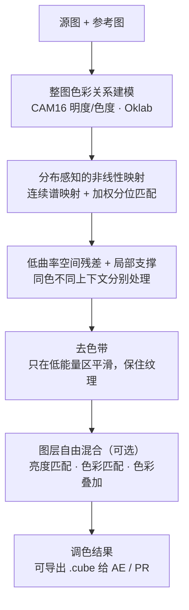

# Velum

[简体中文](./README.md) · [English](./README_EN.md)

> **你的配色很好，下一秒是我的了。**

Velum 是一套**参考图驱动的色彩迁移**工具。给它两张图——一张要调色的**源图**，一张你想要的**参考图**——它把参考图的色调、明暗关系、色彩气质搬到源图上，同时**保住源图自己的构图和纹理**。

它有两种形态，同一套内核：

- **ComfyUI 节点** `Velum 色彩迁移 (4.10.1)` —— 塞进工作流里，自动跑批。
- **独立调色台（网页）** —— 双击 `一键启动.bat` 就开，**不需要先装 ComfyUI**，滑杆实时调，边看边改。

---

## 它到底好在哪

市面上的色彩迁移，多数是在某个颜色空间里做**一次全局仿射变换**：整体平移一下、缩放一下。快是真快，但能力有天花板——它没办法"把天空往蓝里推、同时把皮肤留在原地"。

Velum 走的是另一条路：



翻译成人话，它比传统做法多做了三件事：

1. **它不只会"整体挪"，还会"重新排队"。** 同一个亮度区间里的不同颜色，可以被送到不同的目的地。传统仿射做不到这点。
2. **它看分布，不看均值。** 用加权分位匹配和连续谱映射对齐两张图的色彩分布，而不是只对一对均值和方差。
3. **它顺手把色带灭了。** 大多数色彩迁移搬完之后，天空渐变会出现一层层"台阶"。Velum 自带去色带，而且只在低能量区域动手，源图的线条和细节不会被抹平。

---

## 六格对比，自己看差距

调色台内置 **六格对比**，一键出图，直接把主流做法和 Velum 排在一起：

| | | |
|---|---|---|
| **源图** | **reinhard** | **mkl** |
| **参考图** | **hm-mkl-hm** | **VELUM** |

这三位的脾气，实现代码里的注释写得很直白：

- **reinhard**（2001 年经典，Ruderman lab 里的均值/方差迁移）：一个全局仿射映射。好处是稳，代价是**无法重排色调**；而且标准差比值没有上界，参考图偏一点，它就能给你造出参考图里根本不存在的艳色。
- **mkl**（Monge–Kantorovich 线性最优传输）：比 reinhard 聪明，连通道之间的相关性（协方差）一起匹配。但**它依然是一个全局仿射映射**，同样没办法把不同颜色路由到不同终点。
- **hm-mkl-hm**（直方图匹配 + MKL 串起来）：逐通道 CDF 精确匹配，贪心、直接。代价是当参考图的 CDF 很窄时，源图一堆亮度级会被压到同一级上——**这就是色带的来源**。

想在两个版本之间细看差异，用 **AB 对比**：拖动分割线左右拉，对比对象可选 `hm-mkl-hm` / `mkl` / `reinhard` / `源图`，还有 **`cube 预览`**——用它可以直接看"原生 Velum 调色"和"Velum 导出的 LUT 版本"差多少。

---

## 13 组实测案例

每行从左到右：**源图 / 参考图 / HM-MKL-HM / MKL / Reinhard / Velum（关闭去色带）/ Velum（自动去色带）**。每格标签里是该算法的耗时（同批次 5 轮暖态中位数，不含读图和 PNG 编码）。

> 说明：这组对比图由 **Velum 4.07 内核**生成，4.10.1 的算法主体相同，但做过稳定性与速度优化，个别案例的观感可能略有差异。

[](./docs/comparison.jpg)

> 点击可看大图。


## 调色台能干什么

- **三种查看模式**：单独出图 / 六格对比 / AB 对比。
- **图层混合**（Photoshop 风格，从上到下叠加）：
  - **亮度匹配** —— 把源图的明暗关系还回来
  - **色彩匹配** —— 把源图的色彩还回来
  - **色彩叠加** —— 叠加通道可选 `源图` / `reinhard` / `hm-mkl-hm`，模式可选 `叠加` / `滤色` / `正片叠底` / `颜色`，叠加后自动拉回 Velum 明度
  - 两个匹配滑杆都拉到 0 = **100% 原图**，逐像素一致，不改一个字节
- **去色带**：自动推断，或手动给强度；区域算法可选 `梯度能量`（默认）/ `DoG 引导滤波` / `原始 DoG`。
- **计算设备**：自动（优先 GPU）/ CPU / GPU，显存不够自动回退。
- **导出 `.cube`**：一键生成 65³ 3D LUT，AE Lumetri、PR 直接挂，**图层设置全部烘焙进去**。保存路径用系统原生对话框，**记住上次保存的目录**。
- 分辨率切换、放大查看、下载结果、亮色/暗色皮肤。
- 图片直接拖入，或 `Ctrl+V` 粘贴。

---

## 谁适合用它


- **美术 / 概念设计**：拿一张参考图，批量把整组图拉到统一色调。
- **AI创作者**：用ai抽卡，生成了多张镜头关键帧，但是色调不统一，velum可以帮你统一调性。
- **摄影 / 视频后期**：先在调色台里把色调定下来，导出 LUT，回 AE / PR 批量应用。
- **ComfyUI 玩家**：色彩迁移接在生成之后校色，作为工作流里的一环，跟着批处理一起跑。
- **完全不想折腾环境的人**：Windows 下解压、双击、出图。

  

---

## 快速开始

### 方式一：ComfyUI 节点

```
ComfyUI/custom_nodes/ComfyUI-Velum/
```

重启 ComfyUI，搜索 **"Velum 色彩迁移"**，用两个 `Load Image` 分别接源图和参考图，输出接 `Preview Image` / `Save Image`。

**依赖**（Torch 和 Pillow 由 ComfyUI 提供，不要替换）：

```
numpy>=1.26,<2.2
scipy>=1.11,<1.16
numba>=0.62,<0.65
colour-science>=0.4.6,<0.4.7
opencv-python>=4.8,<4.12
```

**节点参数**

| 参数 | 说明 |
|---|---|
| `source_image` | 要调色的源图，输出保持它原本的尺寸 |
| `reference_image` | 色彩参考图，尺寸可以不一样；批次为 1 或与源图等长 |
| `deband_mode` | `auto` / `off` / `manual` |
| `manual_strength` | 仅 `manual` 模式下使用 |
| `backend` | `auto` / `cpu` / `gpu` |
| `cpu_workers` | CPU 线程上限，不会动全局 Torch / OpenCV 线程设置 |
| `structure_field` | 去色带区域算法：梯度能量 / DoG 引导滤波 / 原始 DoG |
| `strength` | 调色结果与原图的混合比例，1 = 完整调色，0 = 直接输出原图并跳过计算 |

参考图为单张时，可以广播给整批源图；等长时逐张配对。其他组合会明确报错，**不会静默循环或错配**。

### 方式二：独立调色台（免装 ComfyUI）

- **Windows CPU 整合包**：从 [Releases](../../releases) 下载 `Velum-4.10.1-CPU-Windows-x64.zip`，完整解压后双击 **`一键启动.bat`**。自带 Python 3.12.10 和全部依赖，**不用装 Python、不用装 ComfyUI、不会联网安装任何东西**。
- **已有 Python 环境**：克隆本仓库后，双击目录里的 `一键启动.bat`（默认 8899 端口，冲突自动递增）。
- 怀疑环境有问题？双击 **`一键自检.bat`**，它会检查依赖、跑一张小图，并输出诊断 JSON。

有意思的是：**同一个文件夹，两种身份兼得。** 把这个文件夹丢进 `ComfyUI/custom_nodes`，节点会自动使用 ComfyUI 自己的 Python 和 Torch/CUDA；单独启动时则用内置的 CPU 环境。它不会改你的模块路径、不会覆盖你的包，也不碰全局环境变量。

---

## 导出 LUT，进 AE / PR

在调色台调好之后，点 **`导出.cube`**：

- 输出 **65³ 3D LUT**，色彩约定是 **sRGB / Rec.709 编码 RGB、全范围 0–1、SDR**。Log / HDR / ACES 素材请先转到这个空间，或者把 LUT 挂在色彩转换之后。
- 当前的分辨率、调色参数，以及亮度匹配、色彩匹配、色彩叠加的通道/模式/强度，**全部烘焙进 LUT**。
- 拟合方式：对"源图 → 网页最终显示结果"做**曲率正则化三线性最小二乘**，而不是把色卡重新送去做分布匹配。原图没出现过的颜色会平滑外推，不会在视频里冒出奇怪的颜色。
- 导出后会**直接告诉你误差**（平均值和 P95），超过 4/255 会提示你先预览检查。
- 一个 LUT 对应一个镜头/场景的固定映射，**不会逐帧闪烁**。

**实测误差**（1280 宽源图、留出像素做验证、求解器完全收敛）：

| 场景 | 平均误差 |
|---|---|
| 默认图层 | 3.4 / 255 |
| 12 种叠加通道 × 模式组合 | 1.6 – 2.4 / 255 |

**一个诚实的边界**：LUT 本质上是"同一个颜色只能对应一个输出"。而 Velum 的去色带会看像素**所在的位置**，所以它没法被完整塞进 LUT——这部分只能取平均近似。关掉去色带时，理论上可以完全复刻。这也是我们专门做了 `cube 预览` 对比项的原因：让你自己看见差在哪。

---

## 速度与稳定性

本机 RTX 5090、8 线程实测（不同图片和负载会有出入）：

| 场景 | 耗时 |
|---|---|
| 2944×1648，AUTO | 约 4.7 s |
| 1600×1965，CPU | 约 4.1 s |
| 1600×1965，GPU | 约 3.4 s |
| PNG 无损编码 | 约 0.36 s |
| 网页缓存命中 | 约 0.41 s |

第一张总会慢一些（内核编译、worker 启动、GPU 初始化），从第二张起才是上面的数字。

**它被设计成"出事也只炸自己"：**

- Velum 的计算只在**独立的子进程**里跑，ComfyUI 宿主不导入它的 Numba / SciPy / OpenCV 内核。
- 子进程以 `-I` 启动，忽略 `PYTHONPATH` 和用户 site 目录，不会污染宿主环境。
- 原生崩溃或超时会被转换成**清晰的节点报错**，附上退出码和日志路径，不伪装成成功、也不会在宿主里偷偷重试。
- 每次运行都会写下 `runtime_info.json`，记录真实的启动模块、线程和计算后端——排查问题时有据可查。
- worker 会被复用；空闲一段时间后自动退出，把显存还回去。

---


## 项目结构

```text
__init__.py              ComfyUI 节点注册
nodes.py                 ComfyUI 节点：IMAGE 批处理、参数校验、报告
worker.py                隔离子进程入口
isolated_client.py       宿主与 worker 的通信（进程隔离）
launch_web.py            独立网页启动入口（离线自检 + 启动）
一键启动.bat              双击即可启动独立调色台
一键自检.bat              依赖检查 + 真实 CPU 小图自检
_velum410/               Velum 色彩迁移内核
web/                     调色台网页（服务、前端、LUT 生成与保存）
js/                      ComfyUI 前端中文界面脚本
ENGINE_MANIFEST.json     内核文件来源与 SHA256
```

独立调色台默认只监听 `127.0.0.1`。如果确实需要在**可信局域网**内使用，可以运行
`python web/server.py --host 0.0.0.0 --port 8899`；它面向的是共享内存的单用户工作台，
不是多用户隔离服务，请不要直接暴露到公网。此时远端设备无法使用"导出 .cube"（该功能限定本机同源）。

---

## 许可证与致谢

本项目以 **Apache License 2.0** 发布，全文见 [LICENSE](./LICENSE)。

第三方参考：

- Reinhard et al. 2001, *Color Transfer between Images*, IEEE CG&A — <https://doi.org/10.1109/38.946629>
- `hm-mkl-hm` 流水线思路受 [color-matcher](https://github.com/hahnec/color-matcher)（MIT）启发，本项目为**独立重新实现**，未复制其源码。
