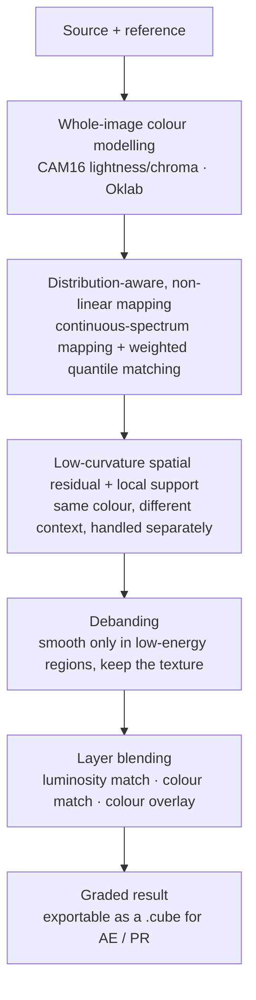
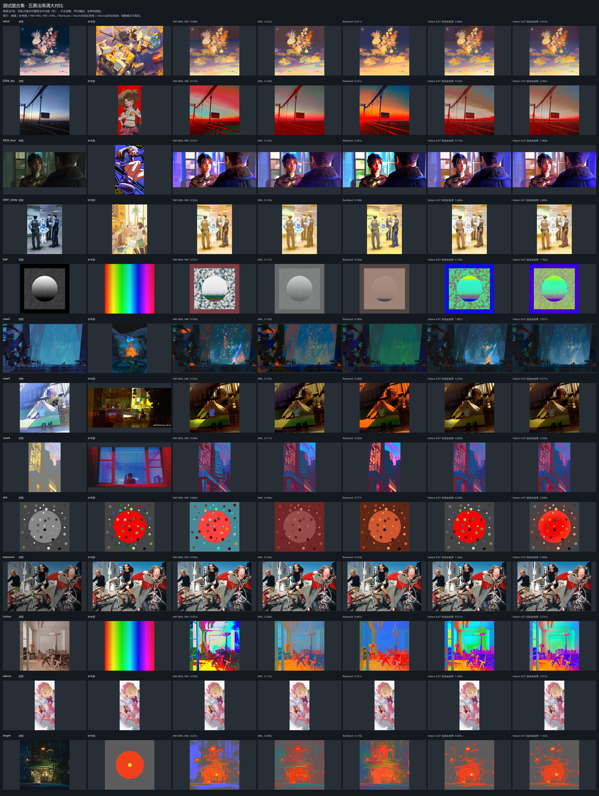
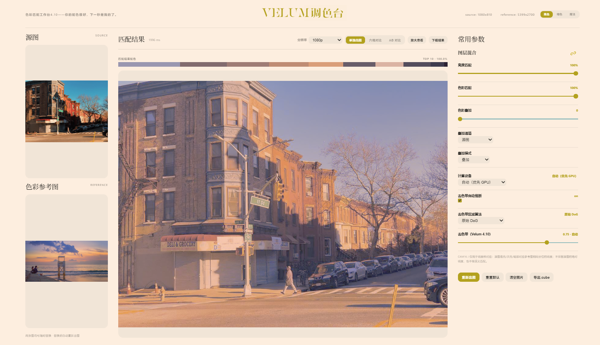

# Velum

[简体中文](./README.md) · [English](./README_EN.md)

> **Your palette is lovely. Mine next.**
> Take the colours of any reference image and move them onto yours.

Velum is a **reference-driven colour transfer** tool. Give it two images — a **source** to be graded and a **reference** whose look you want — and it moves the reference's tonality, luminance relationships and colour character onto the source, **while keeping the source's own composition and texture intact**.

It comes in two forms sharing one engine:

- **ComfyUI node** `Velum 色彩迁移 (4.10.1)` — drop it into a workflow and let it batch.
- **Standalone grading console (web)** — double-click `一键启动.bat` to open it, **with no ComfyUI required**. Drag sliders, watch the result live.

---

## Why it's better

Most colour transfer tools in the wild perform **a single global affine transform** in some colour space: shift things a bit, scale things a bit. Fast, certainly — but with a hard ceiling. That approach cannot "push the sky toward blue while leaving skin alone".

Velum takes a different path:



In plain terms, it does three things a classic affine transfer cannot:

1. **It doesn't just move colours — it re-orders them.** Different colours at the same luminance can be routed to different destinations. A global affine map fundamentally cannot do this.
2. **It looks at distributions, not just averages.** Weighted quantile matching and continuous-spectrum mapping align the two images' colour distributions, instead of matching one pair of means and variances.
3. **It kills banding along the way.** Most colour transfer leaves visible stair-stepping across sky gradients. Velum debands, and only in low-energy regions, so your line art and fine detail survive untouched.

---

## Six-panel comparison — see the gap yourself

The console has a built-in **six-panel comparison**. One click lays the mainstream approaches out next to Velum:

| | | |
|---|---|---|
| **source** | **reinhard** | **mkl** |
| **reference** | **hm-mkl-hm** | **VELUM** |

The implementation comments describe each of those three bluntly:

- **reinhard** (the 2001 classic — mean/std transfer in Ruderman lab space): one global affine map. Stable, but it **cannot re-order tonality**; and because the std ratio is unbounded, a slightly odd reference can invent saturation that the reference never had.
- **mkl** (Monge–Kantorovich linear optimal transport): smarter than reinhard — it also matches inter-channel correlation (covariance). But **it is still one global affine map**, so it likewise cannot route different colours to different destinations.
- **hm-mkl-hm** (histogram matching chained with MKL): per-channel CDF matching, greedy and direct. The cost is that when the reference's CDF is narrow, a whole range of source levels collapses onto one output level — **that is exactly where banding comes from**.

To inspect a difference closely, use **A/B compare**: drag the splitter left and right. The comparison target can be `hm-mkl-hm` / `mkl` / `reinhard` / `source`, plus **`cube preview`** — which shows you directly how far "native Velum grading" is from "the LUT version Velum exports".

---

## 13 real test cases

Each row, left to right: **source / reference / HM-MKL-HM / MKL / Reinhard / Velum (debanding off) / Velum (auto debanding)**. Each panel label shows that algorithm's run time (warm median of 5 runs in one batch, excluding image loading and PNG encoding).

> Note: this sheet was produced with the **Velum 4.07 engine**. 4.10.1 keeps the same core algorithm with stability and speed work on top, so individual cases may look slightly different.

[](./docs/comparison.jpg)

> Click for full size.


## What the console can do
[](./docs/webui.png)
- **Three view modes**: single output / six-panel comparison / A-B comparison.
- **Layer blending** (Photoshop-style, stacked bottom to top):
  - **Luminosity match** — hand the source's light-and-dark relationships back
  - **Colour match** — hand the source's colours back
  - **Colour overlay** — overlay channel `source` / `reinhard` / `hm-mkl-hm`, mode `overlay` / `screen` / `multiply` / `color`; the result is pulled back to Velum's luminosity afterwards
  - Both match sliders at 0 gives **100% the original image**, pixel for pixel, without altering a single byte
- **Debanding**: automatic inference or a manual strength; the region algorithm can be `gradient energy` (default) / `DoG guided filter` / `raw DoG`.
- **Compute device**: auto (GPU preferred) / CPU / GPU, falling back automatically when VRAM runs short.
- **`.cube` export**: one click generates a 65³ 3D LUT that AE Lumetri and Premiere load directly — **all your layer settings are baked in**. The save dialog is the native Windows one, and it **remembers the last folder**.
- Resolution presets, zoom-to-inspect, result download, light/dark skin.
- Drag images in, or paste with `Ctrl+V`.

---

## Who it's for

- **Artists / concept design**: take one reference image and pull a whole set of images to a consistent tone.
- **AI creators**: gacha out several keyframes for a shot, find their colour completely inconsistent — Velum unifies the tonality for you.
- **Photography / video post**: lock the look in the console first, export a LUT, then apply it in bulk back in AE / PR.
- **ComfyUI users**: wire colour transfer in after generation as a grading step, and let it run with the batch.
- **Anyone who doesn't want to touch an environment**: on Windows, unzip, double-click, done.

---

## Quick start

### Option 1: ComfyUI node

```
ComfyUI/custom_nodes/ComfyUI-Velum/
```

Restart ComfyUI, search for **"Velum 色彩迁移"**, wire two `Load Image` nodes to source and reference, and send the output to `Preview Image` / `Save Image`.

**Dependencies** (Torch and Pillow come from ComfyUI — do not replace them):

```
numpy>=1.26,<2.2
scipy>=1.11,<1.16
numba>=0.62,<0.65
colour-science>=0.4.6,<0.4.7
opencv-python>=4.8,<4.12
```

**Node inputs**

| Input | Description |
|---|---|
| `source_image` | the image to grade; the output keeps its original size |
| `reference_image` | the colour reference; any size, batch of 1 or the same length as the source |
| `deband_mode` | `auto` / `off` / `manual` |
| `manual_strength` | used only by `manual` mode |
| `backend` | `auto` / `cpu` / `gpu` |
| `cpu_workers` | CPU thread cap; never touches global Torch / OpenCV thread settings |
| `structure_field` | deband region algorithm: gradient energy / DoG guided / raw DoG |
| `strength` | blend between graded result and original: 1 = full grade, 0 = output the original and skip the compute |

A single reference image broadcasts across the whole source batch; equal-length batches are paired one-to-one. Any other combination fails with a clear error — it **never silently loops or mismatches**.

### Option 2: standalone console (no ComfyUI)

- **Windows CPU bundle**: download `Velum-4.10.1-CPU-Windows-x64.zip` from [Releases](../../releases), unzip it completely, then double-click **`一键启动.bat`**. It ships Python 3.12.10 and every dependency — **no Python install, no ComfyUI, no network installs of any kind**.
- **Existing Python**: clone this repo and double-click `一键启动.bat` in the directory (defaults to port 8899, auto-increments if busy).
- **Suspect something is off with the environment?** Double-click **`一键自检.bat`**. It checks dependencies, runs a small image for real, and writes a diagnostic JSON.

The neat part: **one folder, two identities.** Drop the folder into `ComfyUI/custom_nodes` and the node uses ComfyUI's own Python and Torch/CUDA. Launch it standalone and it uses its bundled CPU environment. It does not rewrite your module paths, does not overwrite your packages, and does not touch global environment variables.

---

## Export a LUT for AE / PR

Once the look is right in the console, hit **`导出.cube`** (Export .cube):

- Output is a **65³ 3D LUT**, in **sRGB / Rec.709 encoded RGB, full range 0–1, SDR**. Convert Log / HDR / ACES material into that space first, or place the LUT after your colour-space conversion.
- The current resolution, grading parameters, and the luminosity match, colour match, and colour overlay channel / mode / strength are **all baked into the LUT**.
- Fitting method: a **curvature-regularised trilinear least-squares** fit from "source image → final console display", rather than feeding a colour chart back through the distribution matcher. Colours that never appeared in the image extrapolate smoothly, so nothing bizarre shows up later in video.
- After exporting, it **tells you the error directly** (mean and P95). Above 4/255 it suggests you preview first.
- One LUT is a fixed mapping for one shot/scene — it **will not flicker frame to frame**.

**Measured error** (1280-wide source, held-out pixels, solver fully converged):

| Scenario | Mean error |
|---|---|
| default layers | 3.4 / 255 |
| 12 overlay channel × mode combinations | 1.6 – 2.4 / 255 |

**One honest limitation**: a LUT is, by definition, "one colour in → one colour out". Velum's debanding looks at **where a pixel is**, so it cannot be fully packed into a LUT — that part is approximated by an average. With debanding off, it is in theory exactly reproducible. That is precisely why the `cube preview` comparison exists: so you can see for yourself where the difference lies.

---

## Speed and stability

Measured locally on an RTX 5090 with 8 threads (your mileage will vary with image and load):

| Scenario | Time |
|---|---|
| 2944×1648, AUTO | ~4.7 s |
| 1600×1965, CPU | ~4.1 s |
| 1600×1965, GPU | ~3.4 s |
| PNG lossless encode | ~0.36 s |
| web console cache hit | ~0.41 s |

The first image is always slower (kernel compilation, worker startup, GPU init). The numbers above apply from the second image on.

**It is designed so that a failure only ever takes itself down:**

- Velum's compute runs in a **separate child process**; the ComfyUI host never imports its Numba / SciPy / OpenCV kernels.
- The child starts with `-I`, ignoring `PYTHONPATH` and user site directories, so it cannot pollute the host environment.
- Native crashes and timeouts are converted into **clear node errors** with the exit code and log path — never disguised as success, and never silently retried inside the host.
- Every run writes a `runtime_info.json` recording the actual startup modules, threads and compute backend, so problems are traceable.
- Workers are reused, and exit automatically after being idle, handing the VRAM back.

---

## Project structure

```text
__init__.py             ComfyUI node registration
nodes.py                ComfyUI node: IMAGE batching, validation, reporting
worker.py               isolated child-process entry point
isolated_client.py      host <-> worker transport (process isolation)
launch_web.py           standalone launcher (offline self-check + start)
一键启动.bat             double-click to start the standalone console
一键自检.bat             dependency check + real small-image self-test
_velum410/              the Velum colour transfer engine
web/                    the console (server, frontend, LUT fitting and saving)
js/                     ComfyUI frontend labels
ENGINE_MANIFEST.json    engine file provenance and SHA256
```

The console listens on `127.0.0.1` only. If you genuinely need it on a **trusted LAN**, run
`python web/server.py --host 0.0.0.0 --port 8899`. It is a shared-memory single-user workbench,
not a multi-user isolated service — do not expose it to the public internet. Remote devices on
that setup cannot use "Export .cube", which is deliberately restricted to loopback same-origin.

---

## License and credits

Released under the **Apache License 2.0** — full text in [LICENSE](./LICENSE).

Third-party references:

- Reinhard et al. 2001, *Color Transfer between Images*, IEEE CG&A — <https://doi.org/10.1109/38.946629>
- The `hm-mkl-hm` pipeline idea was inspired by [color-matcher](https://github.com/hahnec/color-matcher) (MIT). This project is an **independent reimplementation** and copies none of its source code.
